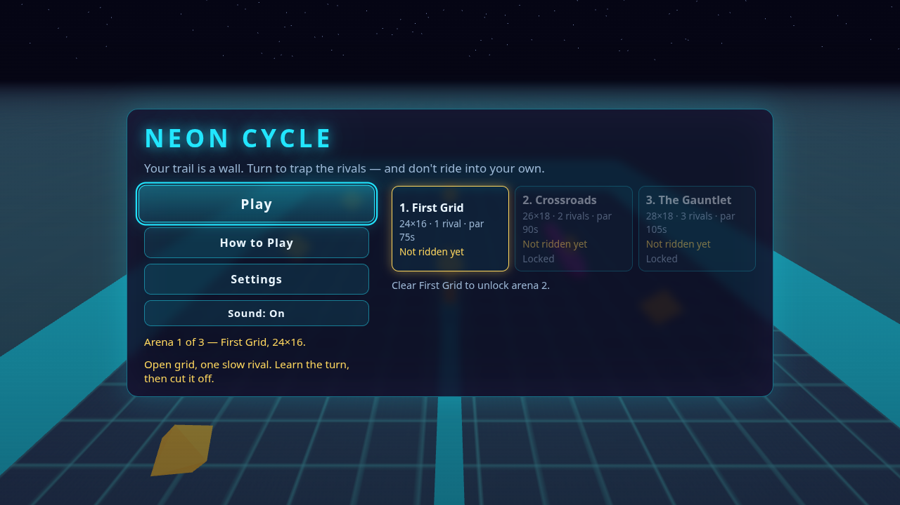
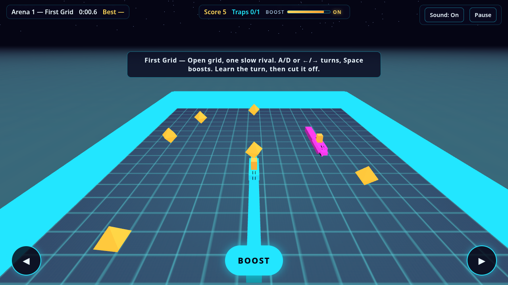

# Neon Cycle — 3D Neon Light-Cycle Arena

Your trail is a wall. Turn to trap the rivals — and don't ride into your own.

**Play it live:** https://namdev-muse.github.io/neon-cycle/

## The game

You ride a light-cycle across a neon grid arena. Everywhere you ride, your trail stays behind you as a solid glowing wall — for you, for the rivals, for everyone. Turn at the right moment to cut a rival off and force it into a wall, and you bank its score. Ride into any trail or the arena edge yourself and the run ends.

- **A / D or Left / Right: turn 90°.** Turns are discrete and queued, so a fast double-tap queues two turns — the turn fires exactly as you cross the next cell centre.
- **Space: toggle boost.** A toggle, never a hold — press once to switch it on, press again to switch it off. Boost drains a meter; riding over gold boost cells refills it. Boosting is a real decision: faster means less time to turn.
- **Trap rivals** by cutting them off (force them into any trail or the wall). A cut-off into *your* trail pays a +200 bonus; traps within 10s of each other build a combo (+100 each step).
- **Score** from survival time + traps + boost cells + combo, plus a clear bonus for trapping every rival. Your best score and rank per arena are saved; clearing an arena unlocks the next one. Ranks: **S** (clear under par), **A** (clear under 1.5× par), **B** (cleared).
- Rival riders carve their own trails and steer with lookahead — they turn toward open space and panic when boxed in. They are not on rails, and they do blunder into walls.

## Arenas (M1: 3)

| # | Arena | Grid | Rivals | Par |
|---|-------|------|--------|-----|
| 1 | First Grid | 24×16 | 1 (VEX) | 75s |
| 2 | Crossroads | 26×18 | 2 (VEX, NOVA) | 90s |
| 3 | The Gauntlet | 28×18 | 3 (VEX, NOVA, ORION) | 105s |

Each arena has its own grid shape, pillar layout, rival count and speed curve — and the 3D scene tints to match (walls, pillars and pocket light all take the arena's accent).

## Controls

- A / D or Left / Right: turn · Space: toggle boost · **P**: pause · **M**: mute · **R**: restart
- Touch: ◀ / ▶ to turn, **BOOST** to toggle boost
- **Esc** closes a panel · **Enter** confirms on menus

## Tech

- Three.js 0.160.0 (pinned, jsdelivr import map), vanilla HTML/CSS/JS, Web Audio API synth SFX, no build step, GitHub Pages from `main` / root.
- Pure simulation core in `physics.js` (no DOM, no Three.js) — deterministic fixed-step grid sim (turn queuing, trail walls, rival AI, boost cells, traps, combo, ranks), driven through public input hooks by the bot harness.
- Game feel: trauma screen shake, hit-stop, slow-mo on the final trap, FOV punch on boost, pooled spark particles, score pops, trap toasts, synth SFX + generative music (Am–F–C–G pad + arpeggio that lifts an octave at speed).
- Tests: `npm test` (smoke 111 + bot gates), `npm run render-check` (headless Chromium: menu, attract demo, accessibility toggles, screen-space turn, boost toggle + drain rate, autopilot clear, crash, pause, shake, rest state, `?arena=` unlock path, endRun race, FPS guard), `npm run screenshots` (1280x720 / 2560x1080 / 1080x2340, menu + settings + gameplay + pause + arena-3 framing, inspected by eye; refreshes `docs/screenshots/`).

## Version

v0.1.0 (M1 core, local only — repo creation + live push belong to the 14:30 milestone run). See [docs/DEVLOG.md](docs/DEVLOG.md) for the sprint log.
